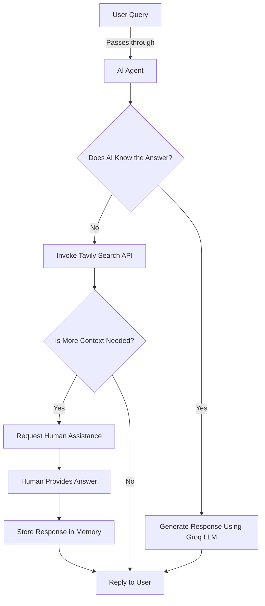

**🤖 Human-in-the-Loop AI Agent with Tavily, Groq Cloud, and Memory**

🚀 Overview
---

This repository contains a Human-in-the-Loop (HITL) AI Agent that intelligently combines LLM-powered automation with human intervention for enhanced decision-making.


It utilizes:


Tavily Search API for retrieving up-to-date information


Groq Cloud for lightning-fast LLM inference


Memory persistence to retain past interactions


LangGraph for workflow automation


This AI system adds human oversight to a web-search agent, for uses such as research assistance, customer support, and AI-driven decision-making.


✨ Features
---

✅ Web search with the Tavily Search API


✅ Human-in-the-Loop Decision Making for complex queries


✅ Conversation Memory using MemorySaver for stateful interactions


✅ Groq Cloud LLMs for cost-effective, high-speed text generation


✅ Automated Workflow powered by LangGraph


✅ Seamless Tool Integration for dynamic tool invocation


🏗️ Architecture
---



This architecture lets the AI handle queries and ask for human assistance when necessary.


⚙️ Installation & Setup
---

1️⃣ Clone the Repository

```
git clone https://github.com/HarxSan/Human-in-the-loop-workflow.git
cd Human-in-the-loop-workflow
```

2️⃣ Install Dependencies

```
pip install -r requirements.txt
```

3️⃣ Set Up Environment Variables


Create a .env file and add:

```
TAVILY_API_KEY=your_tavily_api_key
GROQ_API_KEY=your_groq_api_key
```

4️⃣ Run the AI Agent

Open `Human_in_the_loop_Workflow.ipynb` and run the cells.

🛠️ Usage
---

1️⃣ Start the Agent


Once running, the agent will listen for user queries and decide whether to:


Answer directly using Groq LLM


Search for relevant data via Tavily API


Request human intervention if required


2️⃣ Example Query


User: What are the latest advancements in quantum computing?


Possible AI Workflow:


The AI checks memory for related queries.


If not found, it queries Tavily Search API.


If results are unclear, it asks for human input.


The final response is generated and stored.


3️⃣ Human Intervention


When a complex query arises, the AI triggers:


AI: I need human assistance to ensure accuracy. Please provide insights.


The person supplies the answer, and the model uses it in its reply.


🏆 Why This Matters
---

This system bridges the gap between fully autonomous AI and human expertise, for uses such as:


🔬 Research Assistants


🎯 Customer Support AI


📊 Business Intelligence


📚 Educational Chatbots


🌟 Contributing
---

We welcome contributions! Feel free to fork this repo, make changes, and submit a PR.


Fork the repo


Create a new branch (git checkout -b feature-branch)


Commit changes (git commit -m 'Add new feature')


Push and create a Pull Request


📜 License
---

This project is licensed under the MIT License.


💬 Contact
---

For any queries, feel free to reach out:


📧 Email: hariisankar720@gmail.com🐦


Let’s build smarter AI together! 🚀
